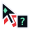
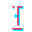

# HOLMES_ Cursors

Pacote com **15 cursores customizados** inspirados na estética *Spider-Verse + Editorial Brutalista* do portfólio [EMANUEL FERREIRA aka HOLMES_](https://emn-f.github.io/holmes/pt-br/).

Disponível em duas variantes:
- **`dark`** — glitch ciano (`#00e5ff`) + vermelho (`#ff0033`)
- **`light`** — editorial cobalto (`#1d4ed8`) + esmeralda (`#6ee7b7`) + vermelho (`#e62429`)

---

## Pré-visualização (15 cursores)

| Cursor | Função | Dark | Light | Hotspot (`32×32`) |
| :--- | :--- | :---: | :---: | :--- |
| `arrow` | Seleção normal |  |  | `(2, 2)` |
| `pointer` | Seleção de link / hover (mira) |  |  | `(12, 12)` |
| `help` | Ajuda |  |  | `(2, 2)` |
| `work` | Trabalhando em segundo plano |  |  | `(2, 2)` |
| `busy` | Ocupado |  |  | `(16, 16)` |
| `cross` | Seleção de precisão |  |  | `(16, 16)` |
| `text` | Seleção de texto (`I-Beam`) |  |  | `(16, 16)` |
| `hand` | Manuscrito / desenho |  |  | `(4, 28)` |
| `unavail` | Indisponível |  |  | `(16, 16)` |
| `vert` | Redimensionamento vertical |  |  | `(16, 16)` |
| `horz` | Redimensionamento horizontal |  |  | `(16, 16)` |
| `dgn1` | Redimensionamento diagonal (`↖↘`) |  |  | `(16, 16)` |
| `dgn2` | Redimensionamento diagonal (`↗↙`) |  |  | `(16, 16)` |
| `move` | Mover |  |  | `(16, 16)` |
| `alternate` | Seleção alternativa |  |  | `(16, 4)` |

---

## Instalação

### Windows 10 / 11

1. Baixe [`holmes-cursors-windows.zip`](./holmes-cursors-windows.zip) (ou pela aba **Releases**).
2. Extraia o arquivo ZIP e entre na pasta `dark/` ou `light/`.
3. Clique com o botão direito em **`install.inf`** → **Instalar** *(no Windows 11: **Mostrar mais opções** → **Instalar**)*.
4. Pressione `Win + R`, execute `main.cpl`, abra a aba **Ponteiros** e selecione **Holmes Dark** ou **Holmes Light** → **OK**.

**Atalho via PowerShell** (dentro da pasta extraída):

```powershell
rundll32.exe setupapi.dll,InstallHinfSection DefaultInstall 132 "$PWD\dark\install.inf"
control main.cpl,,1
```

---

### Linux (GNOME / KDE / Hyprland)

O script [`scripts/install-linux.sh`](./scripts/install-linux.sh) converte todos os SVGs para **XCursor** (`24px`, `32px`, `48px`) com os hotspots exatos e instala em `~/.icons/Holmes-Dark` e `~/.icons/Holmes-Light`.

1. Instale `ImageMagick` e `xcursorgen`:
   ```bash
   # Fedora
   sudo dnf install ImageMagick xcursorgen

   # Ubuntu / Debian
   sudo apt install imagemagick x11-apps
   ```
2. Clone e execute o instalador:
   ```bash
   git clone https://github.com/emn-f/holmes-cursors.git
   cd holmes-cursors
   chmod +x scripts/install-linux.sh
   ./scripts/install-linux.sh all
   ```
3. Ative o tema:
   ```bash
   # GNOME
   gsettings set org.gnome.desktop.interface cursor-theme 'Holmes-Dark'
   gsettings set org.gnome.desktop.interface cursor-size 32
   ```
   - **KDE Plasma:** *Configurações do Sistema → Aparência → Cursores* → selecione **Holmes-Dark** ou **Holmes-Light**.
   - **Hyprland:** adicione em `~/.config/hypr/hyprland.conf`:
     ```ini
     env = XCURSOR_THEME,Holmes-Dark
     env = XCURSOR_SIZE,32
     ```

---

### macOS

O macOS não suporta troca global nativa de temas `.cur` ou `XCursor`. Para usar no Mac:

1. Converta os SVGs de [`dark/`](./dark) ou [`light/`](./light) para PNG em alta resolução:
   ```bash
   brew install imagemagick
   magick -background none -density 384 dark/arrow.svg -resize 64x64 arrow@2x.png
   ```
2. Importe os PNGs com [**Mousecape**](https://github.com/alexzielenski/Mousecape), usando os hotspots da tabela acima (multiplicados por `2` no modo Retina `@2x`).

---

## Licença

MIT — [Emanuel Ferreira (`emn-f`)](https://github.com/emn-f).
