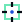
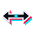
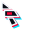
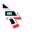
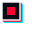
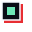

# HOLMES_ Cursors

Custom **15-cursor pack** inspired by the *Spider-Verse + Editorial Brutalist* visual identity of [EMANUEL FERREIRA aka HOLMES_](https://emn-f.github.io/holmes/en/).

Available in two variants:
- **`dark`** — cyan (`#00e5ff`) + red (`#ff0033`) chromatic glitch
- **`light`** — editorial cobalt (`#1d4ed8`) + emerald (`#6ee7b7`) + red (`#e62429`)

---

## Preview (15 cursors)

| Cursor | Role | Dark | Light | Hotspot (`32×32`) |
| :--- | :--- | :---: | :---: | :--- |
| `arrow` | Normal select |  |  | `(2, 2)` |
| `pointer` | Link select / hover (crosshair) |  |  | `(12, 12)` |
| `help` | Help select |  |  | `(2, 2)` |
| `work` | Working in background |  |  | `(2, 2)` |
| `busy` | Busy |  |  | `(16, 16)` |
| `cross` | Precision select |  |  | `(16, 16)` |
| `text` | Text select (`I-Beam`) |  |  | `(16, 16)` |
| `hand` | Handwriting / drawing |  |  | `(4, 28)` |
| `unavail` | Unavailable |  |  | `(16, 16)` |
| `vert` | Vertical resize |  |  | `(16, 16)` |
| `horz` | Horizontal resize |  |  | `(16, 16)` |
| `dgn1` | Diagonal resize (`↖↘`) |  |  | `(16, 16)` |
| `dgn2` | Diagonal resize (`↗↙`) |  |  | `(16, 16)` |
| `move` | Move |  |  | `(16, 16)` |
| `alternate` | Alternate select |  |  | `(16, 4)` |

---

## `arrow` Alternatives (`alternatives/`)

13 additional `arrow` shapes (`dark/` and `light/`, hotspot `(2, 2)`) — sharp, brutalist, geometric, round, and square variants:

| Variant | Dark | Light | Style |
| :--- | :---: | :---: | :--- |
| `02-razor-shard` |  |  | Sharp asymmetric blade |
| `03-brutalist-block` |  |  | 90° orthogonal block |
| `04-origami-kite` |  |  | Directional diamond |
| `05-tri-prism` |  |  | Scalene triangle |
| `06-hex-dart` |  |  | Faceted hex dart |
| `07-target-chevron` |  |  | Chevron + reticle |
| `08-stepped-monolith` |  |  | Glitch-sliced steps |
| `09-orb-teardrop` |  |  | Round teardrop pin |
| `10-halo-circle` |  |  | Pure circle + precision dot |
| `11-soft-arrow` |  |  | Soft-edged arrow |
| `12-directional-squircle` |  |  | Rounded square + sharp tip |
| `13-brutalist-cube` |  |  | Sharp 90° cube |
| `14-soft-box` |  |  | Rounded square + circle core |

---

## Installation

### Windows 10 / 11

1. Download [`holmes-cursors-windows.zip`](https://github.com/emn-f/holmes-cursors/releases/latest/download/holmes-cursors-windows.zip) from the **Releases** page (or directly from this repository).
2. Extract the ZIP archive and open the `dark/` or `light/` folder.
3. Right-click **`install.inf`** → **Install** *(on Windows 11: **Show more options** → **Install**)*.
4. Press `Win + R`, run `main.cpl`, open the **Pointers** tab, and select **Holmes Dark** or **Holmes Light** → **OK**.

**PowerShell shortcut** (inside the extracted folder):

```powershell
rundll32.exe setupapi.dll,InstallHinfSection DefaultInstall 132 "$PWD\dark\install.inf"
control main.cpl,,1
```

---

### Linux (GNOME / KDE / Hyprland)

The [`scripts/install-linux.sh`](./scripts/install-linux.sh) script converts all SVGs into **XCursor** themes (`24px`, `32px`, `48px`) with exact hotspots and installs them to `~/.icons/Holmes-Dark` and `~/.icons/Holmes-Light`.

1. Install `ImageMagick` and `xcursorgen`:
   ```bash
   # Fedora
   sudo dnf install ImageMagick xcursorgen

   # Ubuntu / Debian
   sudo apt install imagemagick x11-apps
   ```
2. Clone and run the installer:
   ```bash
   git clone https://github.com/emn-f/holmes-cursors.git
   cd holmes-cursors
   chmod +x scripts/install-linux.sh
   ./scripts/install-linux.sh all
   ```
3. Enable the theme:
   ```bash
   # GNOME
   gsettings set org.gnome.desktop.interface cursor-theme 'Holmes-Dark'
   gsettings set org.gnome.desktop.interface cursor-size 32
   ```
   - **KDE Plasma:** *System Settings → Appearance → Cursors* → select **Holmes-Dark** or **Holmes-Light**.
   - **Hyprland:** add to `~/.config/hypr/hyprland.conf`:
     ```ini
     env = XCURSOR_THEME,Holmes-Dark
     env = XCURSOR_SIZE,32
     ```

---

### macOS

macOS does not natively support system-wide `.cur` or `XCursor` themes. To use these cursors on a Mac:

1. Convert the SVGs from [`dark/`](./dark) or [`light/`](./light) to high-resolution PNGs:
   ```bash
   brew install imagemagick
   magick -background none -density 384 dark/arrow.svg -resize 64x64 arrow@2x.png
   ```
2. Import the PNGs using [**Mousecape**](https://github.com/alexzielenski/Mousecape), matching the hotspots in the table above (multiplied by `2` for Retina `@2x`).

---

## License

MIT — [Emanuel Ferreira (`emn-f`)](https://github.com/emn-f).
